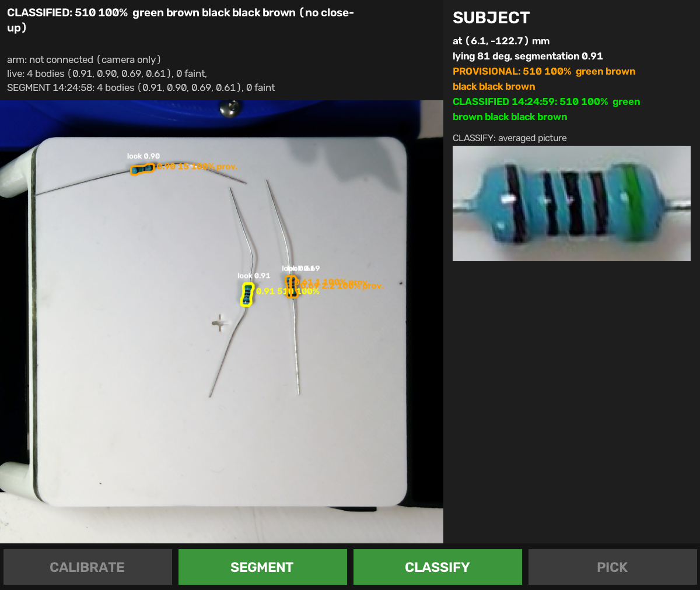

# Tools

Small programs for testing one part of the system at a time. Run them from the `EE52043` folder.
For the sorter itself, see the [README](README.md).

## Vision terminal

`scripts/vision_terminal.py` shows how well segmentation and band reading work, live, one resistor at a time.
You can also pick the resistor you're looking at. It reuses the sorter's camera code, window, calibration
and arm moves, so what you see here is what a sorting run would see.



### Running it

```
python scripts/vision_terminal.py                     # camera, arm and gripper
python scripts/vision_terminal.py --camera-only       # camera only: SEGMENT and CLASSIFY
python scripts/vision_terminal.py --bin A1            # PICK drops in A1 (default B4)
python scripts/vision_terminal.py --frames logs/clear_20261112_205808   # no rig: saved pictures
```

| Option | What it does |
|---|---|
| `--camera-only` | No arm or gripper. CALIBRATE and PICK stay grey. |
| `--bin BIN` | The bin PICK drops in (default `B4`). |
| `--frames FOLDER` | Plays the `.jpg` plate pictures in a folder instead of the camera, 30 s each. Use full camera frames, such as a run's `look_*.jpg`. No arm, no focus check, no close-ups. Good for trying the window with nothing plugged in. |
| `--no-closeups` | CLASSIFY reads from the averaged picture only, without a close-up. |
| `--cad` | Aim picks by the CAD geometry instead of `camera_calibration.json`. |
| `--port PORT` | The Nucleo's serial port, if it isn't found by itself. |

Nothing else may be using the camera. Keep a hand on the servo supply's plug whenever the arm moves.

### The window

**Left: the plate, live.** Every frame is segmented, and each body's bands are read from that single frame.
Each outline's label is its segmentation score, then its reading.

| Outline | Meaning |
|---|---|
| Yellow, thick | The subject (the resistor you clicked) |
| Orange | A body. Its reading is marked `prov.` (provisional): one frame, no focus check, no close-up. A `?` after the value means the reader isn't sure. |
| Green | A body that CLASSIFY has read. It keeps that reading while it stays within 4 mm of where it was read. |
| Grey, thin | A faint detection, below the sorter's confidence. |
| White | The last SEGMENT, labelled `look` and its score. |

**Top: status.** What it's doing now, the arm's state, the live body count with each score and the frame
rate, and the last SEGMENT's count for comparison.

**Right: the subject.** Where it is, which way it lies and its score. Then its provisional reading (orange) and
its classified reading (green), with the band crops CLASSIFY read from.

### The buttons

| Button | What it does |
|---|---|
| click on the plate | Makes the resistor under the click (or within 60 px of its outline) the subject. It's followed from frame to frame. |
| **CALIBRATE** | The standard calibration, as in `sort_resistors_auto.py`: the arm started, the plate found **empty**, the aim checked. First, after a power-on, with the servo supply off: slide fully up, elbow folded to 100° or more, gripper turned away from the tower; then supply on. |
| **SEGMENT** | The sorter's own look: the focus checked, 8 frames averaged, then segmented. Its outlines stay in white over the live view until the next SEGMENT. Use it to compare a single frame with what a run sees. |
| **CLASSIFY** | Reads the subject as a sorting run does: the focus checked on the plate's cross, an averaged picture, then a close-up at the focus its distance needs. Both are read and combined. The result is the CLASSIFIED reading. |
| **PICK** | Finds the subject in an averaged picture, picks it, drops it in `--bin`, then parks. Needs the arm started (CALIBRATE, or `slide_wrist.py start` earlier). |
| q / Esc / ✕ | Quit, once nothing is running. |

The live view pauses while a button uses the camera (CALIBRATE, SEGMENT, CLASSIFY, and PICK's picture).
During PICK's moves it carries on, so you can watch the arm.

### A typical check

1. Lay a few resistors on the plate, keeping the centre cross clear. Watch the live outlines: does every
   body get one, with a steady score, frame after frame?
2. Press **SEGMENT**. Do the white outlines match the live ones? A body found live but not in the look, or the
   other way round, is worth noting.
3. Click a resistor. Its provisional reading in the panel changes from frame to frame. A reading that stays put
   is a good sign.
4. Press **CLASSIFY**. Compare the classified reading with the resistor's real value, and look at the crops
   for focus and glare.
5. If the arm is up, press **PICK** and watch whether the jaws land on it.

### Things to know

- **Live speed:** each frame is segmented whole, so expect about 1 to 3 frames a second. The first frame
  takes a few seconds while the model warms up.
- **Provisional readings aren't trustworthy on their own.** They come from a single frame at whatever focus
  the lens is at. Only CLASSIFY reads as a sorting run does.
- **With `--frames`** there's no close-up or focus check, so CLASSIFY reads from the averaged picture only.
  The pictures change every 30 s, so a SEGMENT can show bodies from the previous picture.
- **PICK uses the sorter's moves and checks,** with the elbow allowed to 140°. The firmware on the board must
  allow that too; see the TODO.

Code: [robot_control/task/vision_terminal.py](robot_control/task/vision_terminal.py) (the window, the live
view and the jobs), [scripts/vision_terminal.py](scripts/vision_terminal.py) (building it). Tests:
[tests/test_vision_terminal.py](tests/test_vision_terminal.py).
